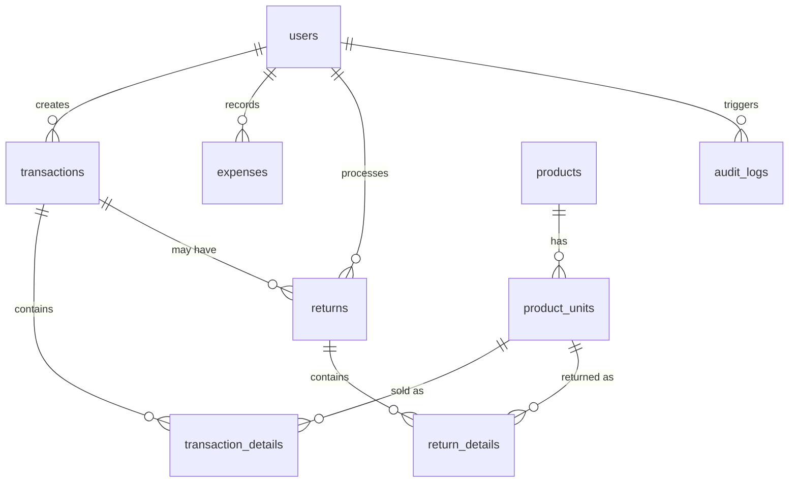

# K-Mate — Codebase Architecture Walkthrough

## Overview

**K-Mate** adalah Sistem POS & Manajemen Inventory untuk Toko Bangunan. Fitur uniknya: **multi-unit conversion** (otomatis konversi Dus → Pcs saat eceran) dan **real-time profit tracking** (Laba Bersih = Omzet - HPP - Pengeluaran - Retur).

---

## Tech Stack

| Layer | Technology | Version |
|-------|-----------|---------|
| **Backend** | Go + Fiber + GORM | Go 1.24, Fiber v2.52 |
| **Frontend** | Vue 3 + Vite + Pinia + TailwindCSS | Vue 3.5, Vite 7.2, Tailwind 4.x |
| **Database** | MySQL 8.0 (via Docker) | Schema v2.2 |
| **AI** | Groq API (LLaMA 3.3 70B) | Tool-calling support |
| **Libraries** | `shopspring/decimal` (precision math), `chart.js`, `lucide-vue-next` (icons), `axios` | — |

---

## Backend Architecture (Go — Clean Architecture)

```
backend/
├── cmd/api/main.go              # Entry point, Fiber app init, CORS, routes
├── config/database.go           # MySQL + GORM connection, AutoMigrate
├── internal/
│   ├── dto/                     # Request/Response Data Transfer Objects
│   │   ├── auth_dto.go          # Login/Register req/res
│   │   ├── cart_dto.go          # Checkout req, Transaction res
│   │   ├── expense_dto.go       # Expense CRUD req/res
│   │   ├── product_dto.go       # Product + Unit req/res
│   │   ├── report_dto.go        # Dashboard/Financial report res
│   │   └── return_dto.go        # Return/Refund req/res
│   ├── handlers/                # HTTP Controller layer
│   │   ├── ai_handler.go        # POST /chat — AI assistant
│   │   ├── audit_handler.go     # GET /audit-logs — security logs
│   │   ├── auth_handler.go      # POST /auth/login, /auth/register
│   │   ├── expense_handler.go   # CRUD /expenses
│   │   ├── pos_handler.go       # POST /pos/checkout, GET transactions
│   │   ├── product_handler.go   # CRUD /products (multipart + JSON)
│   │   ├── report_handler.go    # GET /dashboard/*, /reports
│   │   └── return_handler.go    # POST /returns
│   ├── middleware/
│   │   └── jwt_auth.go          # JWT validation + RBAC (OwnerOnly, AdminOrOwner, AllStaff)
│   ├── models/                  # GORM struct definitions
│   │   ├── audit_log.go         # AuditLog + JSONMap custom type
│   │   ├── expense.go           # Expense + categories enum
│   │   ├── product.go           # Product + ProductUnit (multi-unit)
│   │   ├── return.go            # Return + ReturnDetail + condition enum
│   │   ├── transaction.go       # Transaction + TransactionDetail + payment enum
│   │   └── user.go              # User + role enum (owner/admin/cashier)
│   ├── repository/              # Data Access Layer (GORM queries)
│   │   ├── audit_repo.go        # Audit log queries
│   │   ├── expense_repo.go      # Expense CRUD + filters
│   │   ├── product_repo.go      # Product/Unit CRUD, stock adjust
│   │   ├── report_repo.go       # Financial aggregations (raw SQL)
│   │   ├── return_repo.go       # Return create with stock restore
│   │   ├── transaction_repo.go  # Atomic checkout (tx + stock deduct)
│   │   └── user_repo.go         # User auth queries
│   ├── routes/
│   │   └── api_routes.go        # All route definitions + DI wiring
│   └── services/                # Business Logic layer
│       ├── ai_service.go        # Groq API + tool calling (stock, sales, restock)
│       ├── auth_service.go      # Login/Register + bcrypt + JWT
│       ├── expense_service.go   # Expense validation + CRUD
│       ├── inventory_service.go # Product/Unit CRUD + validation
│       ├── pos_service.go       # Checkout flow (stock check → deduct → commit)
│       └── return_service.go    # Return processing + stock restore
├── pkg/utils/
│   ├── audit.go                 # Async audit logging (goroutine-safe)
│   ├── jwt.go                   # JWT generate/validate (HS256, 24h expiry)
│   ├── password.go              # Bcrypt hash/check
│   └── response.go              # Standard JSON response wrapper
└── .env                         # DB_DSN, JWT_SECRET, GROQ_API_KEY, PORT
```

### Key Backend Patterns

1. **Dependency Injection**: Semua wiring di [api_routes.go](file:///c:/Users/User/OneDrive/Desktop/project/K-Mate/backend/internal/routes/api_routes.go) — Repo → Service → Handler
2. **Atomic Transactions**: Checkout & Return menggunakan `tx.Begin()` / `tx.Commit()` / `tx.Rollback()`
3. **Price Snapshot**: `cost_at_moment` & `price_at_moment` disimpan saat transaksi untuk akurasi HPP historis
4. **Audit Logging**: Async via goroutine, context data (IP, UserAgent) di-extract sebelum goroutine start
5. **Multi-unit Logic**: Stok selalu dalam **base unit**. `stock_deducted = qty × conversion_factor`

---

## Frontend Architecture (Vue 3 — Composition API)

```
frontend/src/
├── api/
│   └── axiosInstance.js         # Base URL: localhost:3000, auto-inject JWT, 401 handling
├── assets/
│   └── main.css                 # Tailwind imports
├── components/
│   ├── common/
│   │   ├── BaseButton.vue       # Reusable button
│   │   ├── BaseInput.vue        # Reusable input
│   │   └── ChatWidget.vue       # AI assistant floating chat (Groq)
│   ├── dashboard/
│   │   └── StatCard.vue         # Summary cards (omzet, laba, dll)
│   ├── inventory/
│   │   └── ProductFormModal.vue # Add/Edit product form with units & image
│   ├── layout/
│   │   ├── AppLayout.vue        # Main layout wrapper
│   │   ├── Navbar.vue           # Top navigation
│   │   └── Sidebar.vue          # Side navigation (role-based menu)
│   ├── pos/
│   │   ├── CartItem.vue         # Cart line item
│   │   ├── ReturnModal.vue      # Return/refund dialog
│   │   └── UnitSelector.vue     # Unit picker popup (Dus/Pcs/dll)
│   └── receipt/
│       └── ThermalReceipt.vue   # Print-ready thermal receipt layout
├── composables/
│   └── usePrint.js              # Print utility hook
├── router/
│   └── index.js                 # Routes + navigation guard (JWT + RBAC)
├── stores/                      # Pinia state management
│   ├── authStore.js             # Login/register/logout + localStorage
│   ├── cartStore.js             # Cart state, checkout action, lastTransaction
│   ├── productStore.js          # Product CRUD actions, pagination
│   └── receiptStore.js          # Receipt data for printing
├── views/
│   ├── AuditLogView.vue         # Audit log viewer (owner only)
│   ├── DashboardView.vue        # Executive dashboard + charts
│   ├── InventoryView.vue        # Product management table
│   ├── LoginView.vue            # Login page
│   ├── POSView.vue              # Main POS/Cashier interface
│   ├── ReportView.vue           # Financial reports
│   └── TransactionsView.vue     # Transaction history + return
├── App.vue                      # Root (router-view + ThermalReceipt global)
├── main.js                      # Vue app init (Pinia + Router)
└── style.css                    # Global styles
```

### Key Frontend Patterns

1. **Route Guard**: JWT check + role-based access di `router/index.js`
2. **Lazy Loading**: Semua views di-lazy-load (`() => import(...)`)
3. **Pinia Stores**: `authStore` (auth), `cartStore` (POS cart), `productStore` (inventory), `receiptStore` (printing)
4. **Axios Interceptor**: Auto-inject `Authorization: Bearer <token>`, auto-redirect ke `/login` saat 401

---

## Database Schema (9 Tables)



| Table | Purpose | Key Fields |
|-------|---------|------------|
| `users` | Login & role management | `role` ENUM(owner, admin, cashier) |
| `products` | Master data, base unit stock | `stock_qty` always in base unit, `product_code` optional |
| `product_units` | Multi-unit conversion & pricing | `conversion_factor`, `buy_price`, `sell_price` |
| `transactions` | Sales header | `invoice_no` (INV-YYYYMMDD-XXXX), `payment_method` |
| `transaction_details` | Sales items + HPP snapshot | `price_at_moment`, `cost_at_moment` |
| `expenses` | Operational costs | `category` ENUM (operational, salary, restock, maintenance, refund, other) |
| `returns` | Return header | `return_no` (RET-YYYYMMDD-XXXX), `total_refund` |
| `return_details` | Return items | `condition_status` ENUM(good, damaged) |
| `audit_logs` | Security tracking | `old_value`, `new_value` as JSON |

---

## API Endpoints Summary

### Public
| Method | Path | Description |
|--------|------|-------------|
| POST | `/api/v1/auth/login` | Login, returns JWT |
| POST | `/api/v1/auth/register` | Register user |

### Protected (JWT Required)
| Group | Endpoints | Access |
|-------|-----------|--------|
| **Products** | `GET /products`, `GET /products/:id`, `POST /products`, `PUT /products/:id`, `DELETE /products/:id`, `GET /products/low-stock` | GET: All staff, CUD: Admin/Owner |
| **POS** | `POST /pos/checkout`, `GET /pos/transactions/*`, `GET /pos/summary/today` | Checkout: All, Summary: Admin/Owner |
| **Expenses** | `CRUD /expenses`, `GET /expenses/today` | Admin/Owner |
| **Dashboard** | `GET /dashboard/summary`, `/chart`, `/top-products`, `/low-stock` | Owner only |
| **Reports** | `GET /reports` (period-based) | Admin/Owner |
| **Returns** | `POST /returns`, `GET /returns` | POST: All, GET: Admin/Owner |
| **Audit Logs** | `GET /audit-logs`, `GET /audit-logs/actions` | Owner only |
| **AI Chat** | `POST /chat` | All authenticated |

---

## Core Business Logic Flows

### 1. Checkout (POS)
```
Request → Validate items → For each item:
  → Get ProductUnit (conversion_factor, sell_price, buy_price)
  → Calculate stockToDeduct = qty × conversion_factor
  → Check stock_qty >= stockToDeduct
  → Snapshot price_at_moment & cost_at_moment
→ DB Transaction: Create transaction + details + deduct stock (atomic)
→ Return invoice_no, items, total, gross_profit
```

### 2. Return / Refund
```
Request → Validate invoice → For each return item:
  → Check qty ≤ original qty
  → If condition="good": stockToRestore = qty × conversion_factor
  → If condition="damaged": no restock
  → Refund = price_at_moment × qty
→ DB Transaction: Create return + details + restore stock (if good)
→ Create expense record (category=refund)
```

### 3. Financial Report (Net Profit)
```
Net Profit = Total Revenue - Total HPP - Total Expenses
Where:
  Revenue = SUM(transactions.total_amount)
  HPP     = SUM(transaction_details.cost_at_moment × qty)
  Expense = SUM(expenses.amount)
```

---

## Completed Modules ✅

| Module | Backend | Frontend | Status |
|--------|---------|----------|--------|
| Auth (JWT + RBAC) | ✅ | ✅ | Complete |
| Inventory (Multi-unit) | ✅ | ✅ | Complete |
| POS / Kasir | ✅ | ✅ | Complete |
| Keuangan (Expenses) | ✅ | ✅ | Complete |
| Retur Barang | ✅ | ✅ | Complete |
| Laporan Keuangan | ✅ | ✅ | Complete |
| Cetak Struk (Thermal) | — | ✅ | Complete |
| Audit Logging | ✅ | ✅ | Complete |
| AI Assistant (Groq) | ✅ | ✅ | Complete |
| Dashboard (Owner) | ✅ | ✅ | Complete |

---

## Infra & Config Notes

- **Backend Port**: `PORT` env (default 8080), CORS allows `http://localhost:5173`
- **Frontend Port**: Vite default 5173
- **Axios Base URL**: `http://localhost:3000/api/v1` (hardcoded in axiosInstance.js)
- **Docker Compose**: MySQL + phpMyAdmin, schema auto-init via entrypoint
- **File Uploads**: `./uploads/products/` served as static via `/uploads`

> [!IMPORTANT]
> Ada mismatch port: `main.go` defaults port `8080`, tapi `axiosInstance.js` points ke `localhost:3000`. Kemungkinan `.env` mengoverride `PORT=3000`.
